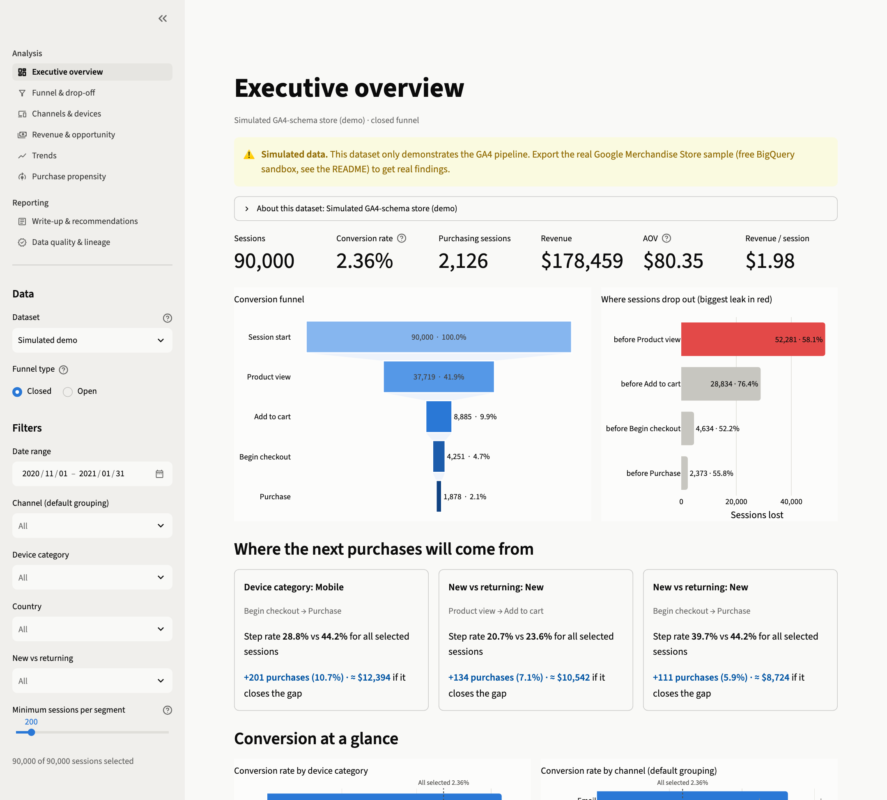
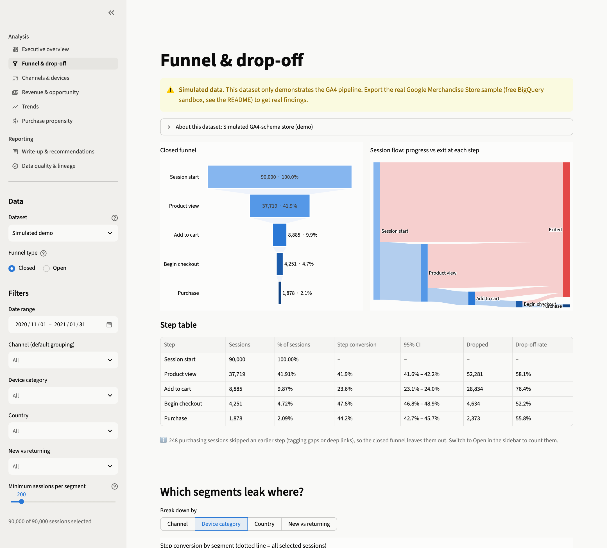
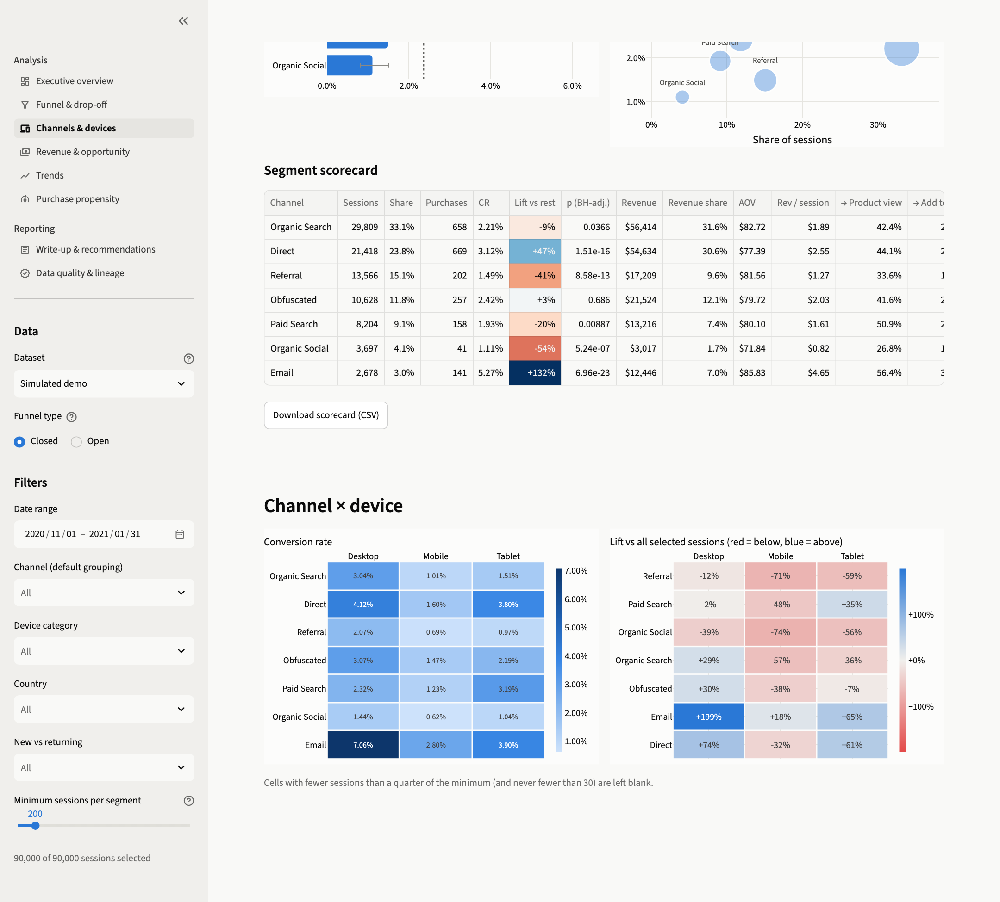
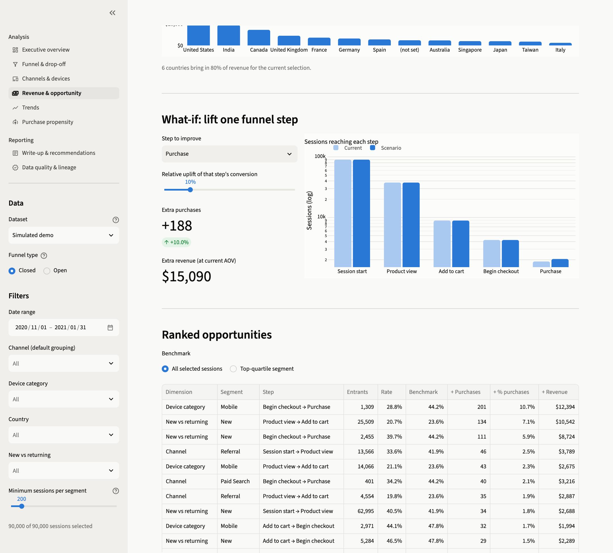
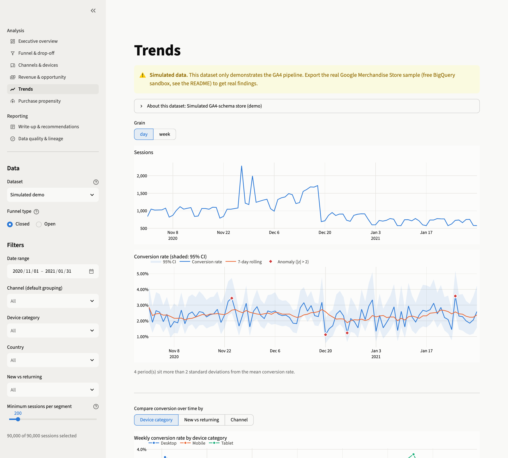
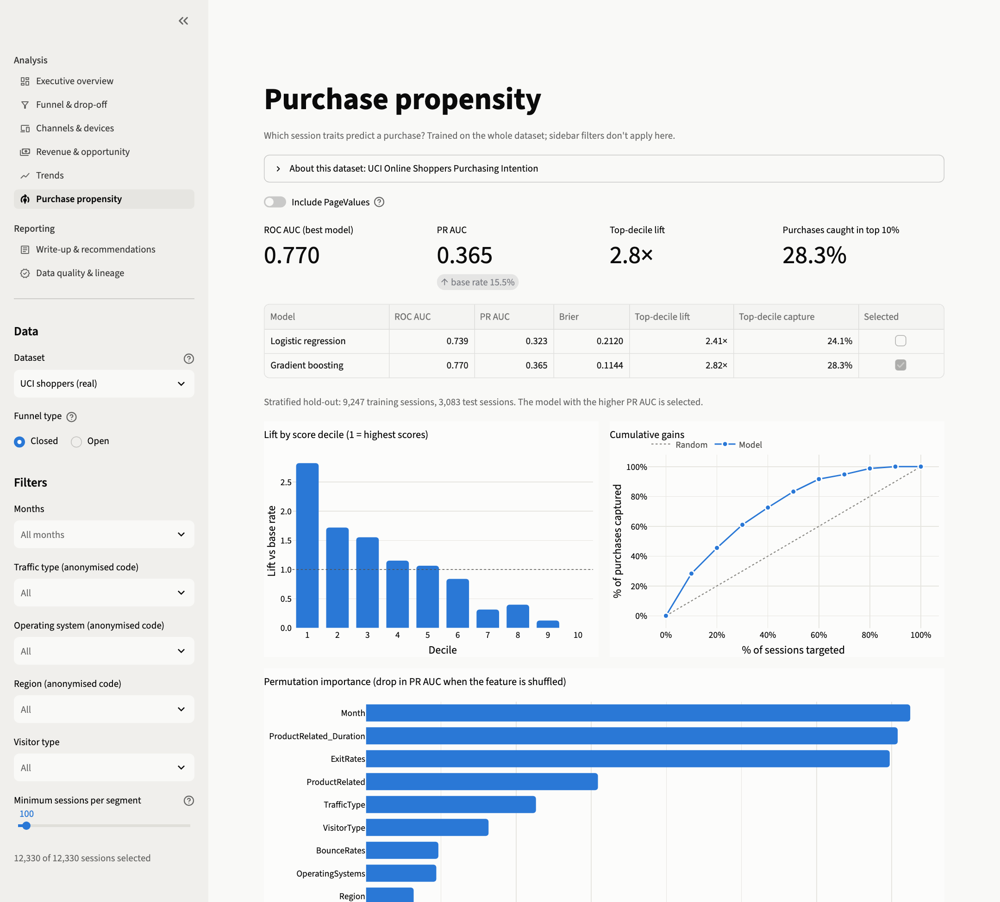
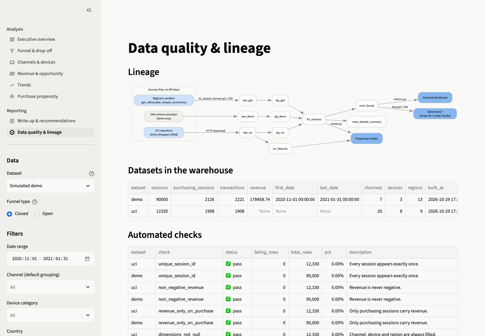
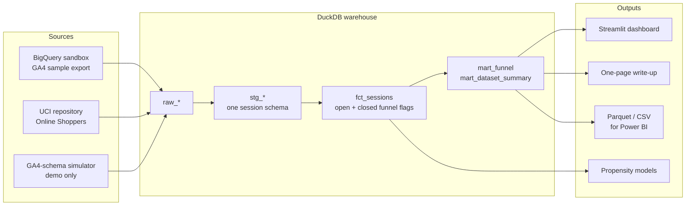

<div align="center">

# E-commerce Conversion Funnel Analytics

**From raw Google Analytics events to sized, testable growth recommendations.**

An end-to-end analytics project that rebuilds the visit-to-purchase funnel from public e-commerce data.
It finds where shoppers drop out, which channels and devices underperform, and how much revenue each fix is worth.

<br>


<br>

[Problem](#the-problem) &nbsp;·&nbsp; [Solution](#the-solution) &nbsp;·&nbsp; [Dashboard](#the-dashboard) &nbsp;·&nbsp; [Findings](#key-findings) &nbsp;·&nbsp; [Tech stack](#tech-stack) &nbsp;·&nbsp; [Architecture](#architecture) &nbsp;·&nbsp; [Run it](#run-it-locally)

<br>



<sub>Executive overview: headline KPIs, the five-step funnel, the biggest leak, and the three largest opportunities, each sized in purchases and revenue.</sub>

</div>

<br>

---

## The problem

An online store pays to bring people in, yet usually only **1 to 3 in every 100 sessions end in a purchase**. The other 97 leave somewhere between landing and paying, and a standard analytics report rarely says where, why, or what it would be worth to fix.

The questions a growth team actually needs answered are:

| Question | Why it is hard with off-the-shelf reports |
|---|---|
| **Where** in the journey do sessions drop out? | Funnel reports mix sessions that skipped steps with sessions that followed the path |
| **Who** drops out: which channels, devices and visitor types? | Segment differences are shown without saying whether they are real or random noise |
| **How much** is each leak worth? | No report turns a conversion gap into extra purchases or revenue |
| **What** should we do first? | Insights stop at charts and never become a ranked, testable plan |

This project answers all four, using only free tools and public data.

<br>

## The solution

A complete analytics product, built the way a data team would ship it:

<table>
<tr>
<td width="50%" valign="top">

**1. Reproducible data pipeline**
<br>
A BigQuery query turns millions of raw GA4 events into one row per session. Every source is mapped onto one five-step funnel and loaded into a DuckDB warehouse through staging, fact and mart layers.

</td>
<td width="50%" valign="top">

**2. Statistically honest metrics**
<br>
Every rate carries a 95% Wilson interval. Segments are tested against the rest with a two-proportion z-test and a Benjamini–Hochberg correction, so the dashboard only calls a gap real when it is.

</td>
</tr>
<tr>
<td width="50%" valign="top">

**3. Opportunity sizing**
<br>
For every segment and every funnel step, the gap to a benchmark is converted into extra purchases and revenue. A what-if simulator shows what lifting any single step would return.

</td>
<td width="50%" valign="top">

**4. Purchase-propensity model**
<br>
Logistic regression and gradient boosting are compared on held-out data, with lift charts and permutation importance. Features that leak the outcome are switched off by default.

</td>
</tr>
<tr>
<td width="50%" valign="top">

**5. Eight-page interactive dashboard**
<br>
Overview, funnel and drop-off, channels and devices, revenue and opportunity, trends, propensity, write-up, and data quality, all driven by one shared set of filters.

</td>
<td width="50%" valign="top">

**6. Built-in quality and reporting**
<br>
Automated data-quality checks fail the pipeline on bad data. A write-up generator drafts a one-page report with three sized recommendations straight from the warehouse.

</td>
</tr>
</table>

<br>

## The dashboard

<table>
<tr>
<td width="50%"></td>
<td width="50%"></td>
</tr>
<tr>
<td align="center"><sub><b>Funnel and drop-off</b>: closed funnel, Sankey flow and a step table with confidence intervals</sub></td>
<td align="center"><sub><b>Channels and devices</b>: segment scorecard with significance, plus channel × device heatmaps</sub></td>
</tr>
<tr>
<td width="50%"></td>
<td width="50%"></td>
</tr>
<tr>
<td align="center"><sub><b>Revenue and opportunity</b>: what-if simulator and opportunities ranked by extra purchases</sub></td>
<td align="center"><sub><b>Trends</b>: daily sessions and conversion with CI band, rolling average and anomaly flags</sub></td>
</tr>
<tr>
<td width="50%"></td>
<td width="50%"></td>
</tr>
<tr>
<td align="center"><sub><b>Purchase propensity</b>: model comparison, lift by decile, cumulative gains and feature importance</sub></td>
<td align="center"><sub><b>Data quality and lineage</b>: lineage graph, warehouse summary and automated checks</sub></td>
</tr>
</table>

<sub>Screens marked "Simulated demo" use a generated store with the exact GA4 export layout, so the full five-step funnel runs before the real export is loaded. Simulated data is labelled on every page and never used for findings.</sub>

<br>

## Key findings

Findings below come from the **real UCI Online Shoppers dataset** (12,330 sessions). The full analysis is in [`docs/WRITEUP.md`](docs/WRITEUP.md).

<div align="center">

| Sessions | Conversion rate | Biggest leak | Best model AUC |
|:---:|:---:|:---:|:---:|
| **12,330** | **15.5%** | **78%** of product viewers never reach a purchase path | **0.77** without leaky features |

</div>

| # | Recommendation | Evidence | Sized impact |
|:---:|---|---|---:|
| 1 | **Re-engage returning visitors at the decision point** | Returning visitors on purchase-path pages buy **51%** of the time, against **86%** for new visitors | **+119 purchases** (+7.8%) |
| 2 | **Fix traffic sources that browse but never show intent** | Traffic type 03 (17% of sessions) reaches the purchase path at **13.7%** vs 22.2% overall | **+94 purchases** (+6.1%) |
| 3 | **Sell earlier in the run-up to special days** | Sessions near a special day convert at **6.2%** vs 16.5% otherwise; May converts at 10.9% on the most traffic | **about +155 purchases** |

<sub>Impact figures are a mechanical gap-to-benchmark calculation: upper bounds to validate with A/B tests, not forecasts.</sub>

<br>

## Tech stack

| Layer | Tools | What they do here |
|---|---|---|
| **Source data** | Google BigQuery sandbox, UCI ML Repository | Free access to the GA4 Merchandise Store export and the Online Shoppers dataset |
| **Extraction** | BigQuery Standard SQL | Sessionises raw GA4 events, dedupes transactions, derives source and medium |
| **Warehouse** | DuckDB, SQL macros | Staging, fact and mart models with a shared channel-grouping macro |
| **Analysis** | Python, pandas, NumPy, SciPy | Funnel maths, Wilson intervals, z-tests, χ² and Cramér's V, BH correction |
| **Machine learning** | scikit-learn | Logistic regression, histogram gradient boosting, permutation importance |
| **Visualisation** | Plotly, Streamlit | Interactive funnel, Sankey, heatmap, trend and lift charts in an eight-page app |
| **Quality** | pytest, SQL assertions | 10 unit and end-to-end tests, 7 data-quality checks per dataset |
| **Delivery** | Parquet and CSV exports, Make | Marts ready for Power BI or Looker Studio, one-command build |

<br>

## Architecture



**One session schema.** Every source maps onto five canonical steps: `visit`, `view`, `cart`, `checkout`, `purchase`. A step a dataset cannot observe is stored as `NULL` and skipped everywhere, so the same metrics code serves every dataset.

**Open vs closed funnel.** A closed funnel counts a step only when every earlier step happened in the same session, which is GA4's default. An open funnel counts any session that fired the step. The gap between the two is reported as funnel leakage.

<br>

## Data sources

Availability was checked on 29 October 2026.

| Dataset | Access | Contents | Role |
|---|---|---|---|
| **GA4 obfuscated sample** <br><sub>`bigquery-public-data.ga4_obfuscated_sample_ecommerce`</sub> | Free BigQuery sandbox, Google account only | Real GA4 events, Nov 2020 to Jan 2021, with channel, device, country and revenue | Primary source |
| **UCI Online Shoppers Purchasing Intention** <br><sub>dataset 468, CC BY 4.0</sub> | Direct download, no login | 12,330 real sessions with page metrics, traffic type, OS, visitor type and a purchase flag | Downloaded automatically |
| **Simulated GA4-schema store** | Generated locally | Same columns as the BigQuery export | Demo only, labelled everywhere |

Olist (Kaggle) was evaluated and left out: it holds orders but no sessions, so it cannot support a visit-to-purchase funnel.

<br>

## Run it locally

```bash
git clone https://github.com/DGskywalker/ecommerce-funnel-analytics.git
cd ecommerce-funnel-analytics
make setup      # virtualenv and dependencies
make all        # download data, build warehouse, run checks and tests, draft write-ups
make app        # open the dashboard at http://localhost:8501
```

Without Make:

```bash
pip install -r requirements.txt
PYTHONPATH=src python -m funnel_analytics.pipeline
streamlit run app/streamlit_app.py
```

<details>
<summary><b>Adding the real GA4 data (free, about five minutes)</b></summary>

<br>

1. Open the [BigQuery console](https://console.cloud.google.com/bigquery) and sign in with any Google account. Sandbox mode needs no credit card.
2. Optionally run `sql/bigquery/02_sanity_checks.sql` to confirm the dataset is still available.
3. Run `sql/bigquery/01_session_funnel.sql`. It returns one row per session and uses a small fraction of the free query tier.
4. Choose **Save results, CSV (Google Drive)**, because the direct download is capped at 10 MB. Download the file into `data/raw/ga4/`.
5. Run `make build`. "GA4 sample (real)" appears in the dataset picker, and `make writeup` drafts its report.

</details>

<details>
<summary><b>Statistical methods</b></summary>

<br>

- **Intervals:** Wilson score 95% confidence interval for every rate.
- **Segment vs rest:** two-proportion z-test, corrected across segments with Benjamini–Hochberg false-discovery control.
- **Independence:** χ² test with Cramér's V as the effect size.
- **Opportunity sizing:** `entrants × max(0, benchmark − rate) × downstream conversion × AOV`, with the benchmark set to all sessions or to the top-quartile segment.
- **Propensity:** stratified 75/25 split, class-weighted logistic regression and histogram gradient boosting, best model chosen on PR AUC. UCI `PageValues` and GA4 in-session engagement are excluded by default because they partly encode the outcome.

</details>

<details>
<summary><b>Using Power BI or Looker Studio</b></summary>

<br>

`make build` writes `data/marts/mart_funnel.parquet` and `.csv` at the dashboard's grain: dataset, date, channel, device, country and visitor type, with sessions, step counts, transactions and revenue. In Power BI Desktop use *Get data, Parquet*, then:

```DAX
Conversion Rate = DIVIDE(SUM(mart_funnel[open_purchase]), SUM(mart_funnel[sessions]))
Cart to Checkout = DIVIDE(SUM(mart_funnel[closed_checkout]), SUM(mart_funnel[closed_cart]))
AOV = DIVIDE(SUM(mart_funnel[revenue]), SUM(mart_funnel[transactions]))
```

</details>

<details>
<summary><b>Free deployment on Streamlit Community Cloud</b></summary>

<br>

Go to [share.streamlit.io](https://share.streamlit.io), choose *New app*, point it at this repository, set the main file to `app/streamlit_app.py` and pick Python 3.11. The app downloads the UCI data and builds the warehouse on first boot. To include real GA4 data, commit a Parquet copy of your export to `data/raw/ga4/` and remove that path from `.gitignore`.

</details>

<br>

## Project structure

```
ecommerce-funnel-analytics/
├── app/
│   ├── streamlit_app.py      entry point and page navigation
│   ├── common.py             theme, palette, cached loaders, sidebar filters
│   ├── charts.py             reusable Plotly figures
│   └── views/                the eight dashboard pages
├── src/funnel_analytics/
│   ├── config.py             paths, funnel steps, dataset registry
│   ├── ingest/               UCI download, GA4 export loader, simulator
│   ├── warehouse.py          model build, quality checks, mart export
│   ├── pipeline.py           command-line orchestration
│   ├── metrics.py            funnel, segments, statistics, sizing, trends
│   ├── model.py              propensity models
│   └── writeup.py            one-page report generator
├── sql/
│   ├── bigquery/             GA4 export and sanity-check queries
│   └── duckdb/               macros, staging and mart models
├── tests/                    unit and end-to-end tests
├── docs/
│   ├── WRITEUP.md            one-page analysis with three recommendations
│   └── images/               dashboard screenshots
├── Makefile
└── requirements.txt
```

<br>

## Skills demonstrated

<div align="center">

`Google Analytics 4` &nbsp; `BigQuery SQL` &nbsp; `Funnel analysis` &nbsp; `Conversion rate optimisation` &nbsp; `Traffic and channel attribution` &nbsp; `Revenue analytics` &nbsp; `Drop-off analysis` &nbsp; `Hypothesis testing` &nbsp; `Multiple-comparison correction` &nbsp; `Opportunity sizing` &nbsp; `Propensity modelling` &nbsp; `Data modelling` &nbsp; `Data quality testing` &nbsp; `Dashboard design`

</div>

<br>

---

<div align="center">
<sub>
UCI data: Sakar, C.O., Polat, S.O., Katircioglu, M. et al. (2019), <i>Neural Computing and Applications</i>, CC BY 4.0.
<br>
GA4 sample provided by Google through the BigQuery Public Datasets programme.
</sub>
</div>
